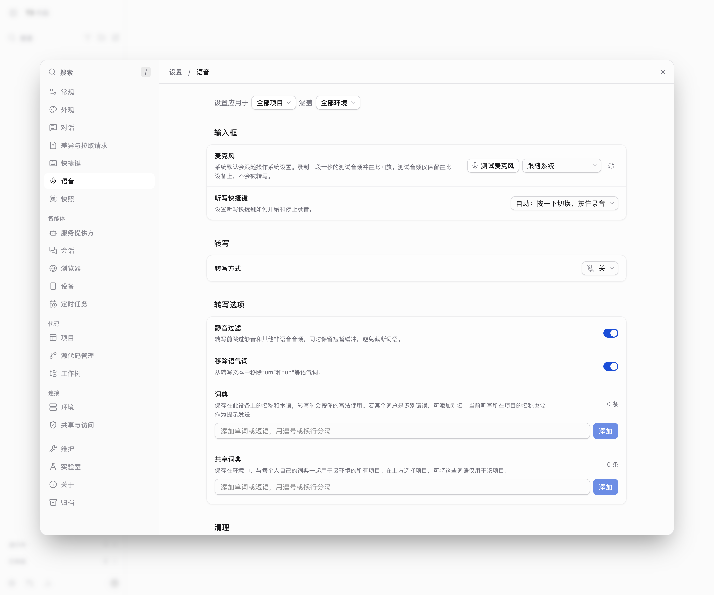

# T3 Code 简体中文汉化

GitHub：[NotoChen/t3-code-zh](https://github.com/NotoChen/t3-code-zh) · [下载 Release](https://github.com/NotoChen/t3-code-zh/releases)

针对 **T3 Code Web UI** 的 Chrome / Edge 扩展。自动识别 T3 Code 页面与 Web 版本，只翻译 T3 Code 自己，不干扰 localhost 上的其他应用。



## 功能

- 覆盖主界面、设置页、菜单、按钮、提示、占位符、错误提示等 UI 文案
- 约 10,000 条精确词条 + 约 1,000 条安全模板
- 自动识别 T3 Code 页面：只有页面标题/应用壳匹配 T3 Code 时才启动翻译
- 自动读取 T3 Code Web 版本，写入 `html[data-t3zh-version]`
- 本地词典，**不联网、不上传内容**
- 不翻译 Agent 输出、代码块、终端输出、Diff 内容

## 支持地址

- `http://localhost:3773`
- `http://127.0.0.1:3773`
- 其它本地端口（仅当页面本身是 T3 Code 时启动）
- `https://app.t3.codes/*`

## 安装

### 从 Release 安装

1. 打开 [最新 Release](https://github.com/NotoChen/t3-code-zh/releases)，下载 `t3-code-zh.zip`
2. 解压到任意目录
3. 打开 Chrome / Edge 扩展管理页：
   - Chrome：`chrome://extensions`
   - Edge：`edge://extensions`
4. 开启 **开发者模式 / Developer mode**
5. 点击 **加载已解压的扩展程序 / Load unpacked**
6. 选择解压后的 `t3-code-zh` 目录
7. 刷新 T3 Code 页面（`Cmd + Shift + R`）

如果已经安装旧版，在扩展管理页点击 **重新加载 / Reload**。

### 从源码安装

```bash
git clone https://github.com/NotoChen/t3-code-zh.git
```

然后按上面的步骤加载 `t3-code-zh` 目录。

## 自动检测工作方式

1. Content script 在 `document_start` 检查页面标题是否包含 `T3 Code`，或页面是否有 T3 Code 的 `boot-shell` + 应用入口。
2. 只有检测通过才启动本地词典和 `MutationObserver`。
3. 版本检测读取当前 Web 的 `assets/index-*.js`，把版本写到：

```text
html[data-t3zh-version]
```

当前检测到 `0.1.9`，控制台会输出：

```text
[T3 Code 中文] detected web version 0.1.9
```

T3 Code 在 SPA 内切换路由时，已启动的观察器继续工作；切换到普通 localhost 应用时不会触发翻译。

## 权限与隐私

扩展没有网络请求、分析、追踪或远程配置。只读取当前页面 DOM 和本地词典。

详见 [PRIVACY.md](PRIVACY.md)。

## 覆盖率

- 源码扫描：2,773 条候选 UI 字符串，2,728 条已覆盖；剩余 45 条为品牌名、路径、命令、内部 ID 和代码片段
- 运行时扫描：23 个页面，818 / 869 条字符串已翻译；剩余 51 条均为项目名、模型名、主题名、键位条件、路径或单位
- 可翻译 UI 文案覆盖率：**100%**

## 已知边界

- 当前词典主要针对 T3 Code Web `0.1.x`。
- T3 Code 更新后如出现新文案，需要补 `translations.js` 或等待新版本词典。
- 不处理桌面端原生菜单、手机 App 内部文案和 T3 服务端返回的部分英文错误。
- 本扩展不是 T3 Code 官方项目，不修改 T3 Code 源码或官方 client。

## 开发与验证

```bash
node tests/validate.cjs       # 检查 manifest、图标、词典和 JavaScript 语法
sh scripts/package.sh         # 生成 dist/t3-code-zh-<version>.zip
```

GitHub Actions 会在 push / pull request 时运行同样的校验和打包。

## 目录

```text
manifest.json       Chrome MV3 清单
content.js          页面检测 + DOM 翻译
translations.js     本地中英文词典
icons/              16/32/48/128 图标
docs/screenshot.png 截图
tests/validate.cjs  扩展校验
scripts/package.sh  打包脚本
.github/workflows/  CI
CHANGELOG.md        版本记录
PRIVACY.md          隐私说明
CONTRIBUTING.md     贡献指南
SECURITY.md         安全说明
LICENSE             MIT
```

## 致谢

- [pingdotgg/t3code](https://github.com/pingdotgg/t3code)：T3 Code 官方项目与英文 UI 来源
- [ZhiweiXiao98/t3code](https://github.com/ZhiweiXiao98/t3code)：社区简体中文词库与源码级 i18n 工作（MIT）
- 所有参与补充词条、截图和测试的贡献者

T3 Code 本身归其原作者所有。本仓库只包含本地汉化扩展代码和词典。

## License

[MIT](LICENSE)
