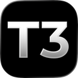
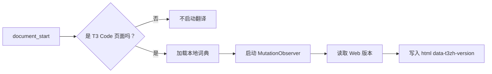

<p align="center">
  
</p>

<h1 align="center">T3 Code 中文界面（社区版）</h1>

<p align="center">
  为 <b>T3 Code Web UI</b> 提供简体中文界面的 Chrome / Edge 扩展。<br/>
  自动识别 T3 Code 页面与 Web 版本，只翻译 T3 Code，不干扰 localhost 上的其他应用。
</p>

<p align="center">
  <a href="https://github.com/NotoChen/t3-code-zh/releases"></a>
  <a href="https://github.com/NotoChen/t3-code-zh/actions/workflows/validate.yml"></a>
  
  
  <a href="LICENSE"></a>
</p>

<p align="center">
  <a href="https://github.com/NotoChen/t3-code-zh">GitHub</a> ·
  <a href="https://github.com/NotoChen/t3-code-zh/releases">下载 Release</a> ·
  <a href="docs/coverage-source.md">源码覆盖率</a> ·
  <a href="docs/coverage-runtime.md">运行时覆盖率</a>
</p>

---

## 一眼看懂

| 项目 | 内容 |
|---|---|
| 类型 | Chrome / Edge Manifest V3 扩展 |
| 作用范围 | T3 Code Web UI |
| 支持版本 | T3 Code Web `0.1.x` |
| 翻译方式 | 本地词典 + DOM 文本替换，不联网 |
| 页面检测 | 标题 / T3 Code 应用壳匹配后才启动 |
| 版本检测 | 从 `assets/index-*.js` 读取，写入 `html[data-t3zh-version]` |
| 词典规模 | 约 10,000 条精确词条 + 约 1,000 条安全模板 |
| 可翻译 UI 覆盖率 | **100%** |
| 许可 | MIT |

## 效果预览

<p align="center">
  
</p>

## 目录

- [功能](#功能)
- [安装](#安装)
- [自动检测机制](#自动检测机制)
- [兼容性](#兼容性)
- [覆盖率](#覆盖率)
- [隐私与权限](#隐私与权限)
- [开发](#开发)
- [目录结构](#目录结构)
- [常见问题](#常见问题)
- [致谢](#致谢)
- [License](#license)

## 功能

- 覆盖主界面、设置页、菜单、按钮、提示、占位符、错误提示等 UI 文案
- 自动识别 T3 Code 页面，普通 localhost 页面不会被翻译
- 自动读取 T3 Code Web 版本，便于排查兼容性问题
- 不翻译 Agent 输出、代码块、终端输出、Diff 内容
- 完全本地运行，无网络请求、无分析、无追踪

## 安装

### 从 Release 安装（推荐）

1. 打开 [最新 Release](https://github.com/NotoChen/t3-code-zh/releases)
2. 下载 `t3-code-zh.zip` 并解压
3. 打开扩展管理页：
   - Chrome：`chrome://extensions`
   - Edge：`edge://extensions`
4. 开启 **开发者模式 / Developer mode**
5. 点击 **加载已解压的扩展程序 / Load unpacked**
6. 选择解压后的 `t3-code-zh` 目录
7. 刷新 T3 Code 页面：`Cmd + Shift + R`

### 从源码安装

```bash
git clone https://github.com/NotoChen/t3-code-zh.git
```

然后按上面的步骤加载 `t3-code-zh` 目录。

> 已安装旧版时，只需要在扩展管理页点击 **重新加载 / Reload**，不需要重新下载。

## 自动检测机制

扩展不会对所有 localhost 页面直接翻译，而是先做轻量检测：



检测依据：

- `document.title` 包含 `T3 Code`
- 或页面存在 T3 Code 的 `boot-shell` + 应用入口

版本检测读取当前 Web 的 `assets/index-*.js`，控制台会输出：

```text
[T3 Code 中文] detected web version 0.1.9
```

T3 Code 在 SPA 内切换路由时，已启动的观察器会继续工作；切换到普通 localhost 应用时不会触发翻译。

## 兼容性

| 环境 | 状态 |
|---|---|
| T3 Code Web `0.1.x` | ✅ 已适配 |
| `http://localhost:3773` | ✅ |
| `http://127.0.0.1:3773` | ✅ |
| 其他本地端口 | ✅（页面本身为 T3 Code 时） |
| `https://app.t3.codes/*` | ✅ |
| T3 Code 桌面端原生菜单 | ❌ 不处理 |
| 手机 App 内部文案 | ❌ 不处理 |

T3 Code 大版本更新后，如果新增了界面文案，词典可能需要补充；检测器会自动降级为页面检测，不影响基本使用。

## 覆盖率

| 口径 | 已翻译 | 总数 | 覆盖率 |
|---|---:|---:|---:|
| 源码候选 UI 字符串 | 2,728 | 2,773 | **98.4%** |
| 可翻译 UI 文案（剔除品牌/路径/命令/内部 ID） | 2,728 | 2,728 | **100%** |
| 运行时字符串 | 818 | 869 | **94.1%** |
| 运行时 UI 文案 | 818 | 818 | **100%** |

详细报告：

- [源码级覆盖率报告](docs/coverage-source.md)
- [运行时覆盖率报告](docs/coverage-runtime.md)

## 隐私与权限

- 不发送网络请求
- 不收集、不存储、不传输用户数据
- 不读取聊天内容、代码、终端输出或 T3 Code 数据库
- 只读取当前页面的 DOM 和扩展内置的本地词典

详见 [PRIVACY.md](PRIVACY.md)。

## 开发

```bash
# 校验 manifest、图标、词典和 JavaScript 语法
node tests/validate.cjs

# 生成 dist/t3-code-zh-<version>.zip
sh scripts/package.sh
```

GitHub Actions 会在 push / pull request 时自动执行校验和打包。

## 目录结构

```text
.
├── manifest.json          Chrome MV3 清单
├── content.js             页面检测 + DOM 翻译
├── translations.js        本地中英文词典
├── icons/                 16 / 32 / 48 / 128 图标
├── docs/
│   ├── screenshot.png     效果截图
│   ├── coverage-source.md 源码覆盖率
│   └── coverage-runtime.md 运行时覆盖率
├── tests/validate.cjs     扩展校验
├── scripts/package.sh     打包脚本
├── .github/workflows/     CI
├── CHANGELOG.md
├── PRIVACY.md
├── CONTRIBUTING.md
├── SECURITY.md
├── LICENSE
└── README.md
```

## 常见问题

<details>
<summary>页面没有翻译怎么办？</summary>

1. 确认页面标题包含 `T3 Code`，或地址是 T3 Code Web。
2. 在 `chrome://extensions` 确认扩展已启用。
3. 点击扩展的 **Reload**，然后刷新 T3 Code 页面。
4. 打开 DevTools Console，确认是否出现 `detected web version` 日志。
</details>

<details>
<summary>为什么普通 localhost 页面没有被翻译？</summary>

这是预期行为。扩展必须先识别页面是 T3 Code，才会启动词典和 MutationObserver，避免误翻其他本地应用。
</details>

<details>
<summary>为什么有些品牌名、路径或快捷键条件没有翻译？</summary>

这些内容不应该机械翻译。比如 `T3 Code`、模型名、`/Users/...`、`git clone`、`composerFocus` 等属于品牌、路径、命令或技术标识，保留原文更准确。
</details>

## 致谢

- [pingdotgg/t3code](https://github.com/pingdotgg/t3code)：T3 Code 官方项目、英文 UI 与官方图标来源
- [ZhiweiXiao98/t3code](https://github.com/ZhiweiXiao98/t3code)：社区简体中文词库与源码级 i18n 工作（MIT）
- 所有参与补充词条、截图和测试的贡献者

T3 Code 本身归其原作者所有。本仓库只包含本地汉化扩展代码和词典。

## License

[MIT](LICENSE)
